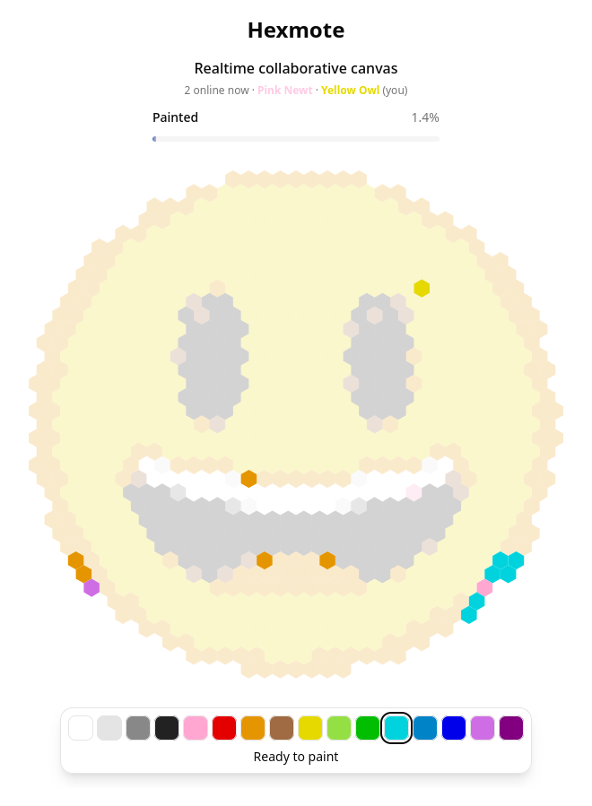

# Hexmote



A shared hex canvas. Visitors paint one cell at a time to recreate a big emote together.
A CQRS and Event Sourcing PoC Demo Project.

https://hexmote.quantum-amplitude.tech
- [Event model](docs/EVENT-MODEL.md)
- [Architecture](docs/ARCHITECTURE.md)
- [Glossary](docs/GLOSSARY.md)

## Run locally

```sh
bun install
cp apps/api/.dev.vars.example apps/api/.dev.vars     # once
cp apps/web/.env.example apps/web/.env.development   # once
cp apps/web/wrangler.example.jsonc apps/web/wrangler.jsonc   # once, set routes and WEB_ORIGIN
bun run dev                                          # API on :8787, web on :3000
```

Create the 😀 canvas once on http://localhost:3000/admin; the same page freezes, resets and deletes
it. Open http://localhost:3000, pick a colour and click a cell; the cooldown is 1 s locally. A private
window is a second painter: both appear online, and each sees the other's paints pulse with a name.

`bun run fill` paints all but 3 cells. Paint those to complete the canvas: a countdown starts, and
1 min later (6 h in prod) a new round begins.

`bun run preview` runs the web Worker itself on :3000, so `/api`, `/live` and `/admin/*` go through
it to the API.

## Share metadata

Icons and the share image are committed in `apps/web/public/`. Metadata, `robots.txt` and
`sitemap.xml` are prerendered from the web Worker's `WEB_ORIGIN`: the site URL in the default
Wrangler config, localhost in `env.preview`. Rebuild after changing it. The Worker build copies
robots and sitemap into static assets so they are served without running the Worker.

## Deploy

Once: `wrangler secret put` each name under `secrets.required` in both `wrangler.jsonc` files, and
put the Turnstile sitekey in `apps/web/.env.production`.

```sh
bun run deploy   # tests and typecheck, then the API Worker, then the web Worker
```

Then create the canvas on `/admin`.
